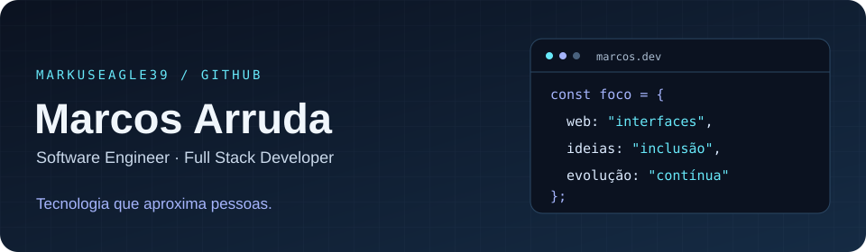

  

  <a href="#-sobre-mim">Sobre mim</a> ·
  <a href="#-projetos-em-destaque">Projetos</a> ·
  <a href="#-conhecimentos">Conhecimentos</a> ·
  <a href="#-em-aprendizado">Em aprendizado</a>

## 👋 Sobre mim

Sou **Marcos**, desenvolvedor de software com experiência em **Front-End**, interfaces digitais e Engenharia de Software. Gosto de transformar ideias em aplicações úteis, com atenção à **acessibilidade e à inclusão**.

Também exploro Inteligência Artificial no desenvolvimento e amplio meus conhecimentos em **Back-End com Python**. Meus projetos passam por ferramentas para o dia a dia, comunicação e jogos para navegador.

> ♿ Acessibilidade faz parte do meu jeito de pensar e construir tecnologia.

## 🚀 Projetos em destaque

<table>
<tr>
<td width="50%" valign="top">

### 📱 QR Code Scanner to Export

Leia QR Codes pela câmera do celular ou computador e exporte as capturas em **TXT ou CSV**, direto no navegador.

**JavaScript · Câmera · Exportação**

<a href="https://markuseagle39.github.io/QR-Code-Scanner-to-export/">↗ Demo</a> · <a href="https://github.com/MarkusEagle39/QR-Code-Scanner-to-export">Código-fonte</a>

</td>
<td width="50%" valign="top">

### 🎮 Eco — Jogo de Memória Acessível

Jogo inspirado no Simon/Genius, com **feedback sonoro**, vibração em dispositivos compatíveis e cores como apoio visual.

**Memória · Acessibilidade · Web**

<a href="https://markuseagle39.github.io/Eco-Accessible-Memory-Game/">↗ Demo</a> · <a href="https://github.com/MarkusEagle39/Eco-Accessible-Memory-Game">Código-fonte</a>

</td>
</tr>
<tr>
<td width="50%" valign="top">

### 🎵 RHYTHM HARMONY — Jogo de ritmo

Protótipo com **quatro colunas de notas**, três dificuldades e controles por teclado ou toque.

**Ritmo · Interação · Web**

<a href="https://markuseagle39.github.io/RHYTHM-HARMONY/">↗ Demo</a> · <a href="https://github.com/MarkusEagle39/RHYTHM-HARMONY">Código-fonte</a>

</td>
<td width="50%" valign="top">

### 🎙️ Transcrição Instantânea

PWA de **voz para texto em tempo real**, criada para facilitar a comunicação entre pessoas surdas e ouvintes.

**Comunicação · Acessibilidade · PWA**

<a href="https://markuseagle39.github.io/transcricao/">↗ Demo</a> · <a href="https://github.com/MarkusEagle39/transcricao">Código-fonte</a>

</td>
</tr>
</table>

## 💻 Conhecimentos

- **🌐 Front-End:** JavaScript, TypeScript, React, Angular, HTML, CSS e Tailwind CSS.
- **🐍 Back End:** SQL e Python.
- **☁️ Cloud e ferramentas:** Azure, Azure DevOps, Jenkins, Git/GitHub e Jira.
- **🤖 Inteligência Artificial:** ChatGPT, Gemini e Claude no desenvolvimento de software e integração de IA em aplicações.
- **🔧 Sistemas embarcados:** C, ESP32, Arduino e Raspberry Pi, com sensores e atuadores.

## 🌱 Em aprendizado

Aprofundando meus estudos em **Full Stack com Python**, **Inteligência Artificial e LLMs** e **Engenharia de Software**.

---

  <strong>Interfaces, ideias e código para aproximar pessoas.</strong> 
  Obrigado pela visita!

